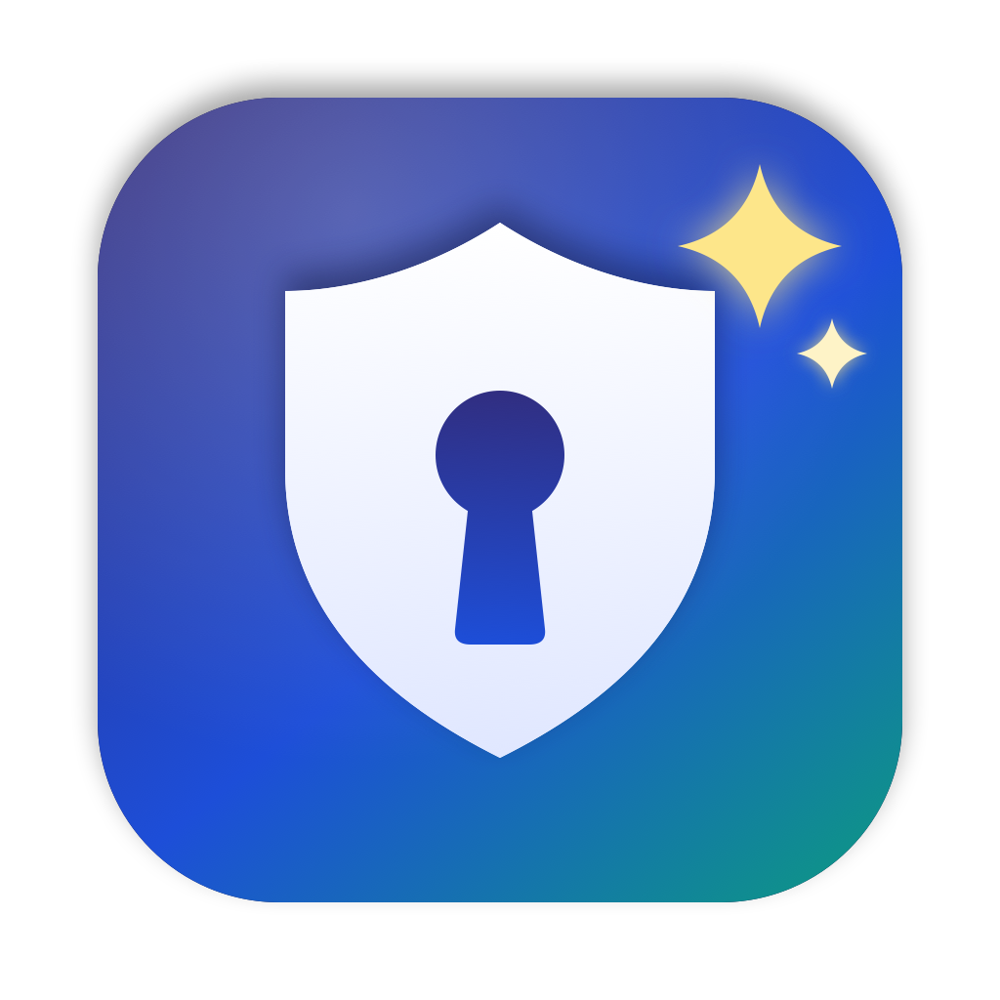

<p align="center"></p>

# Secret Bot

Kubernetes secret talep maillerini okuyup cluster'da kontrol eden ve **sizin onayınızla** oluşturan macOS uygulaması.

Maili yapıştırırsınız; uygulama yapay zekâ ile namespace'leri, secret adını, key'leri ve değerleri çıkarır,
her namespace'i cluster'da kontrol eder (salt okuma + dry-run) ve ne yapılacağını gösterir. Onay vermeden hiçbir şey değişmez.

## Özellikler

- **Çakışma koruması:** Sadece olmayan secret'lar oluşturulur (`kubectl create`). Var olan secret'a varsayılan olarak
  dokunulmaz. Değerleri farklıysa uyarı gösterilir; isterseniz tek tek seçip **onayla** güncelleyebilirsiniz.
  Güncellemede sadece farklı/eksik key'ler yazılır, diğerleri korunur. Kontrolden sonra secret başka biri tarafından
  değiştirildiyse güncelleme `resourceVersion` kilidiyle reddedilir.
- **Değerler gizli kalır:** Mail yapay zekâya gönderilmeden önce değer olabilecek her şey `<<S1>>` gibi etiketlerle
  değiştirilir; gerçek değerler bilgisayarınızda geri konur. Giden metni uygulamada görebilirsiniz.
  Mevcut secret değerleri hiç okunmaz; karşılaştırma SHA-256 hash ile yapılır.
- **Kendi yapay zekânız:** Claude Code (Claude Pro/Max aboneliği, API anahtarı gerekmez), Anthropic API,
  OpenAI uyumlu herhangi bir uç nokta (OpenAI, Ollama, LM Studio, şirket gateway'i) veya yapay zekâsız basit okuyucu.
- **Kendi ortamınız:** kubectl bu bilgisayarda ya da SSH ile bir sunucuda çalışabilir. Context'ler ve ortam
  açıklaması Ayarlar'dan girilir; kodda kişiye/şirkete özgü hiçbir değer yoktur.
- Değerler `data:` alanına base64 olarak yazılır (`type: Opaque`). Secret değerleri komut satırında görünmez
  (stdin üzerinden geçici dosyaya `umask 077` ile yazılıp silinir).
- İşlem kaydı: `~/Library/Application Support/SecretBot/islem.log` (değer yazılmaz).

## Gereksinimler

- macOS 14 veya üstü
- Xcode Command Line Tools (`xcode-select --install`), Swift 5.9+
- kubectl ve python3: bu bilgisayarda **veya** SSH ile erişilen sunucuda
- (İsteğe bağlı) Yapay zekâ: [Claude Code](https://claude.com/product/claude-code) kurulu ve giriş yapılmış,
  ya da bir Anthropic / OpenAI uyumlu API

## Kurulum

```bash
git clone https://github.com/<kullanıcı>/secret-maker.git
cd secret-maker
./build.sh
open "build/Secret Bot.app"
```

İlk açılışta **Ayarlar (⌘,)**:

1. **Bağlantı:** "Bu bilgisayarda" veya "SSH ile bir sunucuda" seçin. SSH için anahtarla giriş (`ssh-copy-id`) hazır olmalı.
   **kubeconfig'ten getir** ile context'leri doldurun, **Bağlantıyı test et** ile doğrulayın.
2. **Yapay zekâ:** "Otomatik" bırakabilirsiniz (Claude Code → Anthropic API → OpenAI uyumlu). Anahtarlar Keychain'de saklanır.
3. **Ortam:** Cluster'larınızı ve namespace isimlendirmenizi kısaca anlatın; yapay zekâ bunu kullanır.

## Kullanım

1. Maili sol tarafa yapıştırın (veya **Panodan yapıştır**). Okuma ve kontrol otomatik yapılır.
2. Talebi kontrol edin; gerekirse **Düzenle** ile düzeltip **Tekrar kontrol et** (⌘R).
3. Durum kartlarında her namespace için: oluşturulacak / zaten var (aynı) / zaten var (farklı) / atlanacak.
4. **Onayla** → son onay penceresinde yapılacaklar ayrı ayrı listelenir → uygulanır ve tekrar kontrol edilerek doğrulanır.

## Komut satırı test aracı

Ayarları uygulamayla aynı yerden okur; hiçbir zaman gerçek değişiklik yapmaz.

```bash
swift build --product secretbot-cli
.build/debug/secretbot-cli --mask examples/ornek-mail.txt    # yapay zekâya gidecek maskeli metin
.build/debug/secretbot-cli --read examples/ornek-mail.txt    # yapay zekâ ile okuma (değerler gizli yazılır)
.build/debug/secretbot-cli examples/ornek-mail.txt dev       # okuma + cluster kontrolü + dry-run
.build/debug/secretbot-cli --contexts local                  # kubeconfig context'leri
```

## Proje yapısı

```
Sources/SecretBotCore/   mail okuma, maskeleme, yapay zekâ sağlayıcıları, kubectl işlemleri
Sources/SecretBot/       SwiftUI arayüzü
Sources/secretbot-cli/   test aracı
icon/make_icon.swift     simgeyi üreten script (swift icon/make_icon.swift icon/AppIcon-1024.png)
```
